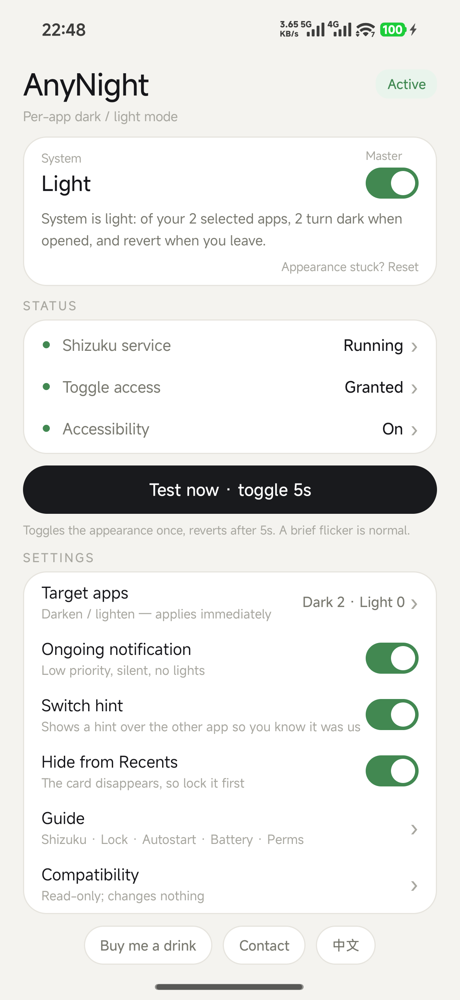
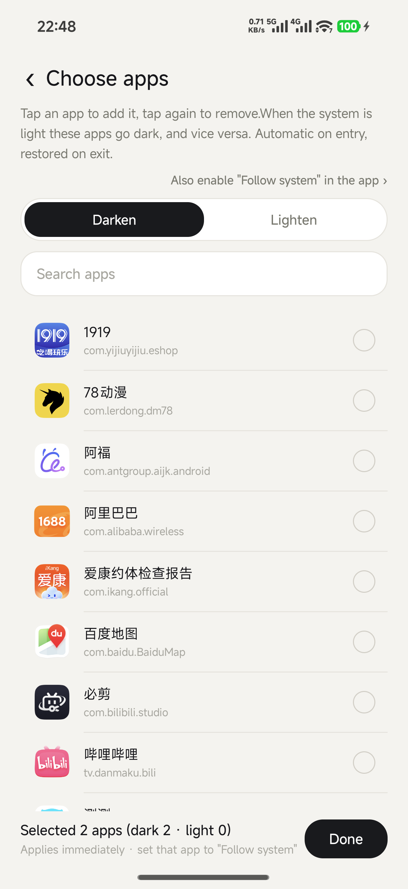
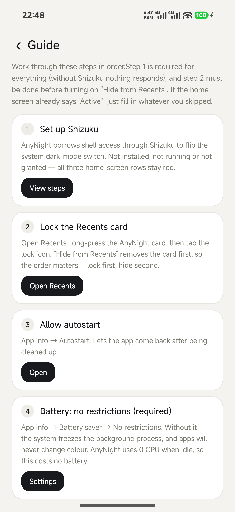

# AnyNight

**Per-app dark / light mode for Android — no root, no Xposed, no repackaging.**

[中文](README.md) · **English**

AnyNight flips the system light/dark switch for you: when you open an app you have picked, the whole system goes dark (or light, whichever you chose for it), and the moment you leave, it goes back to how it was.

If this saves you from one blinding white screen at 2 a.m., a ⭐ helps other people find it.

<p align="center">
  
  
  
</p>

---

## Why this exists

Android has **one** global dark-mode switch and **no public API** for a third-party app to flip it. Some ROMs ship a per-app dark-mode list; many do not, and plenty of apps ignore the system anyway. So the only reliable, non-root way to give a single app its own theme is: borrow shell access through [Shizuku](https://github.com/RikkaApps/Shizuku) and flip the global switch while that app is in front.

That is exactly what AnyNight does — cleanly, and only while you are inside the apps you selected.

## Features

- **Per-app direction** — mark an app *dark* (turn the system dark when it opens) or *light* (turn it light), independently. Both directions work at the same time.
- **Automatic and instant** — event-driven foreground detection (task-stack listener + accessibility + process observer), typically ~50–100 ms from launch to switch.
- **Restores on exit** — leaving the app restores exactly the mode you were in before.
- **Zero polling when idle** — no timers, no wake-ups; 0 CPU while nothing is happening.
- **Double-language UI** — follows the system language, with a one-tap switch (中文 / ENGLISH) at the bottom of the home screen.
- **Overlay hint** — an optional pill over the app saying “switched by AnyNight”, so you can tell our change from an app's own dark mode.
- **Fail-safe** — one-tap restore, automatic reconciliation after a crash or reinstall, a 45 s watchdog while a change is applied, and a 5-second self-reverting test.
- **Read-only compatibility report** — ROM, Android version, Shizuku state, whether night mode is locked, whether per-app dark mode exists; exportable as a zip, with a built-in update check that works over China-friendly mirrors.
- **No analytics, nothing uploaded.** The only network call is the manual "Check for updates" — it asks GitHub for a version number, and only when you tap it.

## How it works

| Piece | What it does |
|---|---|
| `NightModeController` | Talks to `IUiModeManager` through Shizuku: binder transaction first, `cmd uimode night yes/no` as fallback. |
| `TaskStackWatcher` | Foreground detection: `registerTaskStackListener` as the trigger, `getTasks` to resolve the package, accessibility and process-observer events as extra sources. |
| `WatchAccessibilityService` | Decides what to do on entry/exit, persists the pre-change state, applies and restores. |
| `I18n` | Tiny text layer: Chinese strings are the dictionary keys, English is looked up; missing entries fall back to Chinese instead of breaking. |
| `CheckActivity` | Strictly read-only diagnostics — it never toggles anything, so it cannot flicker. |

There is no per-app magic: the *system* switch is what changes. Everything on screen — including the system UI — follows it for those few seconds. What makes it feel per-app is that the switch is only flipped while you are inside the app you picked.

## Requirements

- **Android 11 or newer** (API 30+). Android 13+ recommended.
- **[Shizuku](https://github.com/RikkaApps/Shizuku/releases)** installed, running, and AnyNight authorised inside it.
- **Accessibility service** enabled for AnyNight (this keeps the detection alive on ROMs that freeze background processes).
- On aggressive ROMs (HyperOS / MIUI, ColorOS, OriginOS…): **battery mode “no restrictions”**.

## Download

Latest APK: see [Releases](https://github.com/alienseed/AnyNight/releases/latest).

Mainland-China mirrors for the same file:

- `https://ghfast.top/https://github.com/alienseed/AnyNight/releases/latest/download/app-v1.9.4.apk`
- `https://gh-proxy.com/https://github.com/alienseed/AnyNight/releases/latest/download/app-v1.9.4.apk`
- `https://ghproxy.net/https://github.com/alienseed/AnyNight/releases/latest/download/app-v1.9.4.apk`

The APK is ~344 KB. Package name `com.local.anynight`, version 1.9.4 (versionCode 29). SHA-256 `059d3159ac0ff15f00679ddc0a620a5e34f02bd702553d899a7e0bad09f6fe06`.

> Shizuku itself also needs to come from its official repository — builds delivered by cloud backup, phone-to-phone migration or a vendor app store are often stale or repackaged and fail to pair. The app's built-in guide has the same mirror links.

## Quick start

1. Install Shizuku from the official releases and start it (wireless debugging → pair → start).
2. In Shizuku → *Authorized apps*, enable **AnyNight**.
3. Open AnyNight → grant Shizuku access → enable the accessibility service.
4. **Target apps** → tap the apps you want; use the *Darken / Lighten* segments to choose the direction per app.
5. On aggressive ROMs, set battery to *no restrictions* and allow autostart. The in-app **Guide** walks through it, with buttons that jump straight to the right system page.

Then just use your phone. Enter a picked app → it changes; leave → it changes back.

## If an app does not change

Check these in order — the same list is in the app under **Guide → App did not go dark?**

1. **The app itself must follow the system.** Many apps have their own light/dark switch and default to “always light”. Set it to *Follow system* — in Xiaohongshu that is *Me → Settings → General → Dark mode → Follow system*; most apps hide it under *Settings → Display / Appearance*.
2. **The system may have a per-app dark list.** *Settings → Dark mode → Per-app settings* — if the app is listed there, force it on.
3. **The app may have no dark UI at all.** If neither of the above exists, nothing can make it dark; remove it from the list.

## Notes and honest limits

- **The whole system flips**, including the status bar and the launcher, for as long as you are inside the target app. That is unavoidable without root: there is only one switch.
- **Shizuku stops after a reboot.** Re-open Shizuku and tap *Start* (no re-pairing needed).
- **Some ROMs freeze background apps.** If switching stops working after a while, battery mode is almost always the cause — set it to *no restrictions*.
- **Timing.** The switch happens after the app comes to the front, so a very fast first frame may still be drawn in the old theme for ~100 ms.
- **Not for HarmonyOS NEXT or iOS.** HarmonyOS NEXT has no APK/Shizuku model; iOS exposes no API for a third-party app to change the global appearance.

## Safety

Changing the global appearance could, in theory, leave the system in the “wrong” mode. AnyNight handles that from several directions:

- state is persisted; if the process is killed, the accessibility service reconciles on restart;
- a 45-second watchdog re-checks while a change is applied;
- turning the master switch off restores immediately;
- **Appearance stuck? Reset** on the home screen always works;
- the built-in test asks for confirmation, runs for 5 seconds, and reverts by itself.

## Build from source

```bash
# JDK 17, Android SDK 35, Gradle 8.9
gradle assembleRelease
```

`minSdk 30`, `compileSdk 35`, AGP 8.5.2, Java 17. Only two dependencies: `dev.rikka.shizuku:api` and `:provider`.

## Compatibility

Developed and verified on a Xiaomi 17 Ultra (HyperOS 4.0.7.0, Android 17, SDK 37). The mechanism only relies on AOSP interfaces (`IUiModeManager`, task-stack listener, accessibility), so other Android 11+ devices should work — but vendor ROMs vary.

If something misbehaves, open **Compatibility** in the app, tap **Export log**, and attach the zip to an issue. It contains the ROM, the detected capabilities and the switch log — far more useful than a description.

## Privacy

No analytics, no crash reporting, no accounts, and nothing uploaded. The only network request is "Check for updates": it fetches a version number from GitHub (or a mirror), and only when you tap it. Logs stay in the app's private storage until you export them.

## License

[MIT](LICENSE) © alienleung

## Contact

alienleung@foxmail.com — email is the most reliable channel; attaching an exported log saves a lot of back-and-forth.

If AnyNight is useful to you, **a star is the best thank-you** — it is what decides whether the next person ever finds this.
