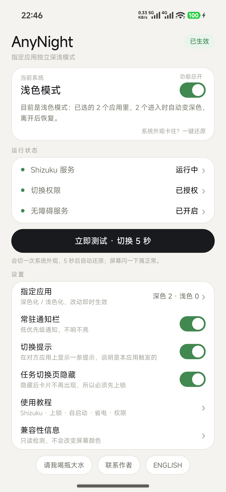
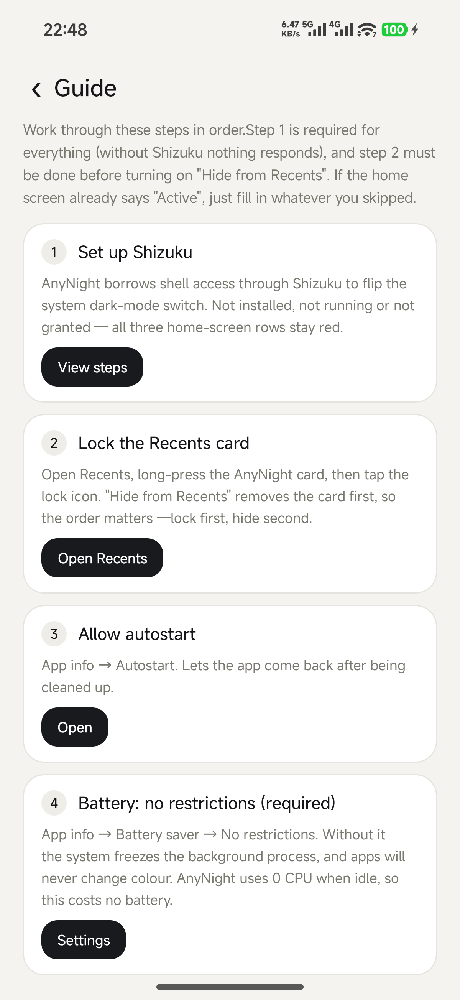

# AnyNight · 指定应用深浅化

**给任意 Android 应用单独设置深色 / 浅色，不用 root、不用 Xposed、不改别人的包。**

**中文** · [English](README.en.md)

你指定哪些应用，AnyNight 就在你进入这些应用时把系统的深浅色开关拨过去，离开时立刻拨回来。系统只有一个总开关，但体验上等于每个应用有了自己的主题。

如果它帮你少看了一次半夜的白屏，**点个 Star** 能让更多需要的人找到它。

<p align="center">
  
  
  
</p>

---

## 为什么需要它

Android 只有一个全局深浅色开关，而且**没有给第三方应用留下切换它的公开接口**。部分国产系统自带「按应用深色」列表，更多系统没有；而且不少应用根本不跟随系统。

所以不 root 的唯一可靠办法是：借 [Shizuku](https://github.com/RikkaApps/Shizuku) 拿到 shell 权限，在目标应用位于前台时拨一下全局开关。AnyNight 做的就是这件事，而且只在你选中的应用里做。

## 功能

- **每个应用单独指定方向** —— 标记为「深色化」的应用进入时把系统切深，标记为「浅色化」的切浅，两个方向可以同时存在。
- **自动、即时** —— 事件驱动的前台识别（任务栈监听 + 无障碍 + 进程观察），从启动到切换通常 50~100ms。
- **离开就还原** —— 还原成你进入之前的那一档，不会留下改过的状态。
- **空闲零轮询** —— 没有定时器、不唤醒；没事发生时 CPU 占用为 0。
- **中英双语界面** —— 跟随系统语言，首页底部一键切换（中文 / ENGLISH）。
- **切换提示** —— 可在对方应用上显示一条小提示，说明「这次是 AnyNight 干的」，避免和它自带的深色开关混淆。
- **兜底完整** —— 首页一键还原、进程被杀后自动对账、改动期间 45 秒看门狗、5 秒自动还原的测试。
- **只读兼容性报告** —— ROM、Android 版本、Shizuku 状态、夜间模式是否被锁定、系统有没有按应用深色，可导出 zip。
- **不联网、不统计、不收集任何数据。**

## 工作原理

| 模块 | 作用 |
|---|---|
| `NightModeController` | 通过 Shizuku 调 `IUiModeManager`：优先 binder 事务，失败回落 `cmd uimode night yes/no`。 |
| `TaskStackWatcher` | 前台识别：`registerTaskStackListener` 作触发，`getTasks` 取包名，无障碍与进程观察事件作补充。 |
| `WatchAccessibilityService` | 进入/离开的判定、持久化改动前的状态、执行与还原。 |
| `I18n` | 极简文案层：中文原文作 key，命中字典返回英文，漏译退回中文而不是显示 key。 |
| `CheckActivity` | 严格只读的诊断页，不写任何设置，因此不可能闪屏。 |

这里没有 per-app 的魔法：真正变化的是**系统的**开关。所以那几秒里系统界面也会跟着变——这正是它能生效的原因。让它「像 per-app」的是：只在你在那个应用里的时候才拨。

## 环境要求

- **Android 11 及以上**（API 30+），建议 Android 13+。
- **[Shizuku](https://github.com/RikkaApps/Shizuku/releases)** 已安装、已启动，并在其中给 AnyNight 授权。
- 开启 AnyNight 的**无障碍服务**（在会冻结后台的系统上，它负责让检测线程活着）。
- 系统较为激进时（HyperOS / MIUI、ColorOS、OriginOS 等）：把**省电策略设为「无限制」**。

## 下载

最新安装包见 [Releases](https://github.com/alienseed/AnyNight/releases/latest)。

国内可直连的镜像（同一个文件）：

- `https://ghfast.top/https://github.com/alienseed/AnyNight/releases/latest/download/app-v1.9.1.apk`
- `https://gh-proxy.com/https://github.com/alienseed/AnyNight/releases/latest/download/app-v1.9.1.apk`
- `https://ghproxy.net/https://github.com/alienseed/AnyNight/releases/latest/download/app-v1.9.1.apk`

安装包约 322 KB，包名 `com.local.anynight`，版本 1.9.1（versionCode 21）。校验值 SHA-256 `d3048a75b2d16b649b95d44700b92ed60c23800d4d19ca1498de80c8c1fff11d`。

> Shizuku 本身也请从官方仓库下载：云恢复、一键换机、系统应用商店里的版本常常偏旧或被替换，典型表现是能装能开但配对一直失败。应用内的 Shizuku 教程页放了同样的镜像链接。

## 快速上手

1. 从官方 Releases 安装 Shizuku 并启动（无线调试 → 配对 → 启用）。
2. 在 Shizuku 的「应用管理」里给 **AnyNight** 打开开关。
3. 打开 AnyNight → 授权 Shizuku → 开启无障碍服务。
4. **指定应用** → 点选应用；顶部用【深色化 / 浅色化】决定这个应用要哪个方向。
5. 系统较激进的话，把省电策略设为「无限制」并允许自启动。应用内的**使用教程**逐步带你做，按钮会直接跳到对应系统页面。

之后正常用手机即可：进入选中的应用就变，离开就还原。

## 应用没变色的排查顺序

应用内「使用教程 → 应用进入后没变深？」里也是这三步：

1. **应用自己得跟随系统。** 很多应用有自己的深色开关，默认「始终浅色」。要在应用内选「跟随系统」——小红书是「我 → 设置 → 通用 → 深色模式 → 跟随系统」；多数应用在「设置 → 显示 / 外观」里。
2. **系统可能自带按应用深色。** 「设置 → 深色模式 → 应用单独设置」里有它，就打开强制变深。
3. **应用可能根本没有深色界面。** 两边都没有，就谁也变不了，建议从清单里移出。

## 说明与限制（实话）

- **整机都会变**，包括状态栏和桌面图标，持续时间等于你在目标应用里的时间。不 root 就没有第二个开关可用，这是机制决定的。
- **重启手机后 Shizuku 会失效**，重新打开 Shizuku 点「启用」即可，不用重新配对。
- **部分系统会冻结后台**。如果用了几天后突然不灵，九成是省电策略，改成「无限制」。
- **有一点点延迟**。切换发生在应用来到前台之后，极快的首帧可能仍是旧主题，约 100ms。
- **鸿蒙 NEXT 与 iOS 不支持**。鸿蒙 NEXT 没有 APK / Shizuku 这套模型；iOS 没有给第三方修改全局外观的接口。

## 安全性

改全局外观理论上可能把系统留在「错误」的一档，所以做了几层兜底：

- 改动前的状态会持久化，进程被杀后无障碍服务一启动就按当前前台对账还原；
- 改动期间每 45 秒一次看门狗核对；
- 关掉总开关立刻还原；
- 首页「系统外观卡住？一键还原」永远可用；
- 内置测试会先弹确认、只切 5 秒、自己还原。

## 从源码构建

```bash
# JDK 17、Android SDK 35、Gradle 8.9
gradle assembleRelease
```

`minSdk 30`、`compileSdk 35`、AGP 8.5.2、Java 17。依赖只有两个：`dev.rikka.shizuku:api` 与 `:provider`。

## 兼容性

主要开发与验证机型：小米 17 Ultra（HyperOS 4.0.7.0 / Android 17 / SDK 37）。机制只依赖 AOSP 接口（`IUiModeManager`、任务栈监听、无障碍），所以 Android 11+ 理论上都可用，但国产 ROM 差异很大。

遇到问题请打开应用内**兼容性信息**页，点**导出报告**，把 zip 附到 issue 里。里面是 ROM、探测到的能力和切换日志，比描述现象有用得多。

## 隐私

没有联网权限。没有统计、没有崩溃上报、没有账号。日志只存在应用私有目录，直到你主动导出。

## 许可

[MIT](LICENSE) © alienleung

## 联系作者

alienleung@foxmail.com —— 邮件最稳妥，附上导出的日志能省掉很多来回问。

如果 AnyNight 对你有用，**一个 Star 就是最好的回礼**：它决定了下一个人能不能找到这里。
